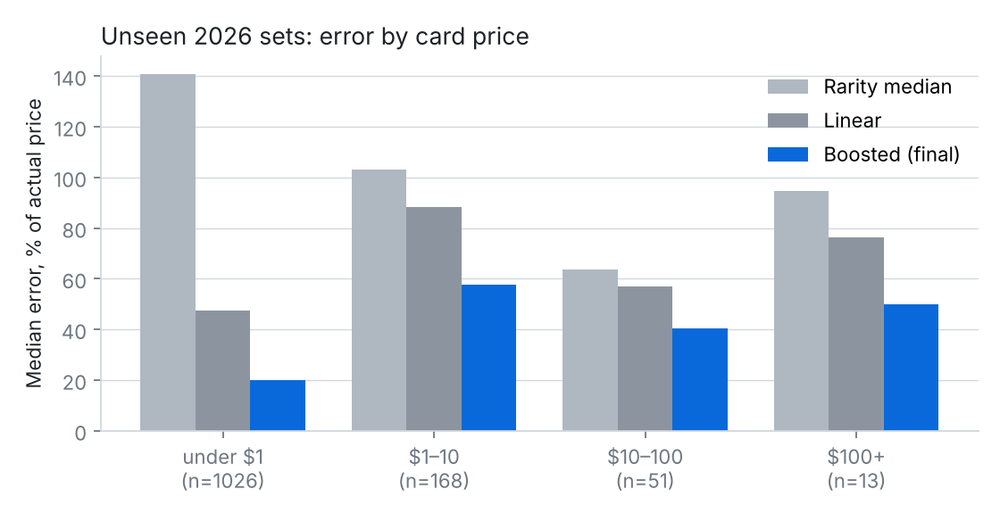
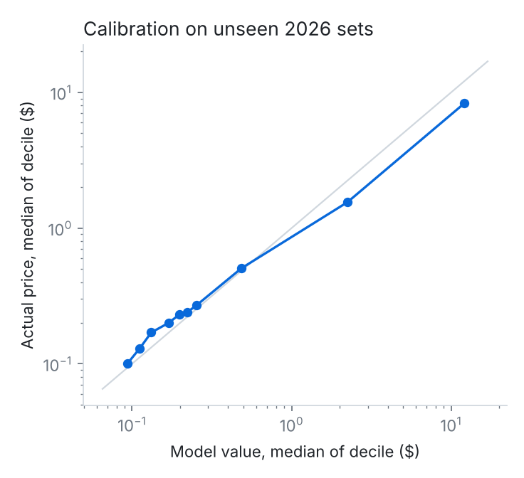
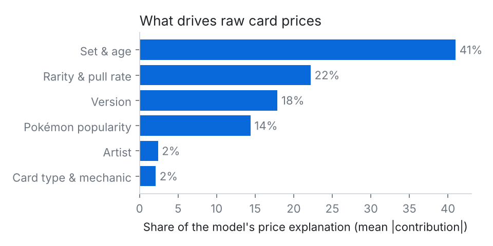

# Raw card value model (step 3)

**Question:** given what's printed on a card and known about it, what should an English near-mint card cost? It's tested on sets the model never saw.

Code: `src/cardlab/models/raw_value.py`. Metrics: `data/derived/raw_value_metrics.json`. Prices are TCGplayer market prices in USD (English cards) from 20 Oct 2026, one snapshot.

## Set-up

| | Sets | Card versions |
|---|---|---|
| Train | released before 2025 (181 sets) | 31,162 |
| Validation (model choice) | released in 2025 (9 sets) | 2,144 |
| **Test (scored once)** | released in 2026 (5 sets: Ascended Heroes, Perfect Order, Chaos Rising, Pitch Black, 30th Celebration) | 1,258 |

- **Split by set and date:** whole sets are held out, so the model never sees any card from a test set.
- **Final model:** refit on train plus validation, then scored on 2026 once.
- **Target:** log price. That keeps a $0.20 and a $200 card on the same footing, so errors are percentages.

## What the model uses (plain words)

- **Rarity & pull rate:**
  - the rarity tier
  - the rarity name
  - secret-rare numbering
  - how many cards share the same rarity in the set (more cards in a slot means each one is harder to pull)
  - the card's rank in its set
- **Version:** finish (normal / holo / reverse), 1st Edition, Shadowless.
- **Set & age:** era, years since release, set size, promo or not.
- **Pokémon popularity:**
  - votes in the 2019 r/pokemon survey and Pokémon of the Year 2020
  - legendary / mythical / starter / pseudo-legendary / Eeveelution
  - how often TPC prints the species
- **Artist:** each artist's typical price level. It's computed only from other sets, so a card never sees its own price.
- **Card type & mechanic:** ex / GX / V / VMAX / Gold Star / Shining / owner's / delta, and so on.

**PSA pop is deliberately left out.** Young sets haven't been graded much yet, so pop misleads exactly where the model is tested. On 2025 validation, error for $10–100 cards fell from 55% to 47% without it. Pop drives the PSA 10 model instead (step 4).

## Results on unseen 2026 sets

The median error is the typical gap between model and actual price, as a % of the actual price.

| Card price | Cards | Rarity median | Linear | **Boosted (final)** | Boosted within ±50% |
|---|---|---|---|---|---|
| under $1 | 1,026 | 141% | 47% | **20%** | 87% |
| $1–10 | 168 | 103% | 88% | **58%** | 45% |
| $10–100 | 51 | 64% | 57% | **41%** | 55% |
| $100+ | 13 | 95% | 76% | **50%** | 54% |
| **All** | 1,258 | 131% | 51% | **23%** | 80% |

- **Coverage:** 54% of cards land within ±25% and 80% within ±50%. R² on log price is 0.88.
- **Price ranges:** built from 2025 validation errors to hold 80% of cards. They contain 89% of 2026 cards, so they're a little cautious.
- **Calibration:** the model is well calibrated overall but slightly over-values the $1–10 band.
- **Sanity check:** the same model trained on shuffled prices is useless (752% error), so the score isn't coming from leakage.

## What drives prices

Each card's price is broken into multipliers by driver, taken from LightGBM's exact per-feature contributions. For example, 151 Charizard ex SIR starts from a base of $1.71, then ×33.2 for rarity & pull rate, ×8.6 for Pokémon popularity, ×1.26 for version, ×1.16 for artist, ×1.06 for card type and ×0.37 for set & age, which comes to $282 (actual $309).

## Honest limits

- **Hype in brand-new chase cards is hard to predict.** The top 2026 hits sold at 2–5× the model value. Ascended Heroes Pikachu ex SIR is $672 against $131 modelled.
- **New rarity names can't be priced.** The model has no idea how rare a rarity it has never seen is. The 2025 Black White Rares (about $460–620) were valued at about $4 by the model trained before 2025. Cards with an unseen rarity are flagged `unseen_rarity = 1` (7 in validation, 32 in test), and their model value shouldn't be trusted.
- **Single snapshot.** These are today's prices for sets of every age, so the age effect is learned across sets, not by watching one set over time. Daily snapshots will make a real history possible.
- **Small samples:** only 13 test cards are above $100, so the top-band numbers are noisy.

## How the model was chosen (validation only)

8 variants were compared on the 2025 sets:

- with and without pull-rate features
- with and without PSA pop
- weighting rare or recent cards
- two tree sizes
- rarity tier with and without the rarity name

The chosen one (no pop, pull-rate features, 31-leaf trees, learning rate 0.02) was best for cards of $10 or more. One rarity mapping was corrected after validation review: "Black White Rare" is the top rarity of Black Bolt / White Flare. The test sets weren't looked at until the final run.
